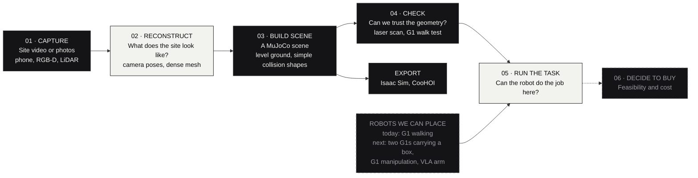
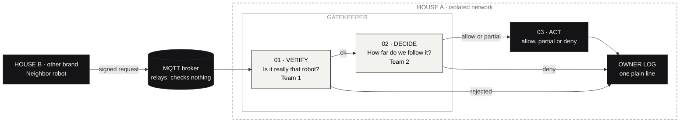

# robot-trust-network

Two pipelines live here. One turns a real site into a simulation, so we can check that a robot can do the job there before anyone buys it. The other is a trust layer, so robots from different owners can work together safely.

## Pipeline 1: site to simulation

Dashed boxes are next. Today the G1 walks in reconstructed scenes; the other robots still run in their own scenes. Heavy reconstruction runs on a Colab GPU, and the geometry is scored against laser scans (ETH3D, Hilti 2022 construction site). The Isaac Sim export will open on an AWS GPU machine with a live screen (g6e.2xlarge, L40S); setup is in [`docs/isaac-sim-hosting.md`](docs/isaac-sim-hosting.md).

## Pipeline 2: trust network

The broker can read every message. Signing proves who sent it and that nothing changed on the way; it does not hide it. The simulation side uses this too: in the MuJoCo duo demo, the follower robot moves only after the leader's signed request is allowed.

## What works today

**Network** (`network/`)
- Signed messages with Ed25519 over canonical JSON
- Verifier that rejects unsigned, unknown or revoked senders, bad signatures, wrong recipient, stale time and replayed nonces
- Trust policy: ALLOW, PARTIAL or DENY per action and trust score, with actions that are never allowed (`unlock_door`)
- Two robots in terminals (`robot.py`), four attacks (`attack.py`: unsigned, spoof, replay, tamper), all rejected
- Link monitor in the browser showing connections, messages, verdicts and the broker log
- Five-stage presentation story (`demo.py`)

**Simulation** (`sim/`)
- `sim/mujoco_houses/`: Unitree G1 and Go1 walking in MuJoCo on published walking policies
  - basic: drive one G1 with WASD
  - duo: a G1 leader and a G1 or Go1 follower linked only through the broker; the follower moves only after a signed request is allowed
  - houses: two RoboCasa kitchens in separate windows talking over MQTT
  - coop carry: two full-body G1s carrying one box (`run_coop_carry`)
- `sim/sunny-scene-recon/`: a scanned site turned into a MuJoCo scene, checked against a laser scan, with a G1 walk test and an Isaac Sim export
- `sim/sam-g1-manipulation/`: a G1 with grippers, picking actions from camera images (experimental)
- `sim/vla_sim.py`: a vision-language model driving a Panda arm or Go2 through skill calls

## Known gaps
- A key revoked mid-task is not noticed until the next request.
- Messages to an offline robot are lost (QoS 0).

## Layout

| Folder | Team | What lives there |
|---|---|---|
| `network/` | Network team | Message signing and verification, key registry, replay protection, MQTT transport, trust and decision rules |
| `sim/` | Simulation team | MuJoCo robots (Unitree demos, manipulation, VLA sim), site reconstruction, Isaac Sim export |
| `docs/` | Everyone | Shared message format, architecture, slides, Isaac Sim hosting |

Start with [`docs/message-format.md`](docs/message-format.md). Both teams build against it, so change it only by agreement.

For a presentation-ready MQTT story, start the link monitor and run
`python network/demo.py --delay 0.9`; see [`network/README.md`](network/README.md#automatic-presentation-demo).
For the walking robots, see [`sim/mujoco_houses/README.md`](sim/mujoco_houses/README.md).

## Roadmap
1. Two robots talk over a shared ROS 2 network
2. Two isolated containers talk only through an MQTT broker, with signed messages (signing done, containers next)
3. Robots in separate containers talk inside the simulator (MuJoCo duo runs over MQTT, not yet in containers)
4. Two real robots in the lab, not on the same server
